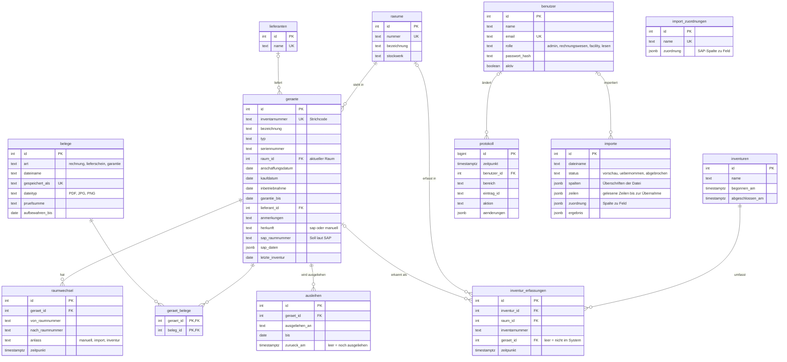

# Datenmodell

Grundlage ist das Pflichtenheft, Kapitel 4 (Speicherung in der DB). Die Tabellen stehen in
[`datenbank/001_tabellen.sql`](../datenbank/001_tabellen.sql), die Ergänzungen für SAP-Import und Ausleihe in
[`datenbank/002_import_und_ausleihe.sql`](../datenbank/002_import_und_ausleihe.sql).

## Soll-Stand und Ist-Stand

- **Soll-Stand** = was laut SAP vorhanden ist. Er steht in `geraete` in den Spalten `sap_raumnummer`, `sap_daten`
  und `sap_importiert_am` und wird nur vom SAP-Import geändert.
- **Aktueller Raum** = `geraete.raum_id`. Er ändert sich, wenn jemand ein Gerät umstellt oder eine Inventur
  übernommen wird. Jeder Wechsel steht mit Zeitpunkt in `raumwechsel`.
- **Ist-Stand** = was bei der Inventur gefunden wurde: `inventur_erfassungen`. Das kann auch eine Inventarnummer
  sein, die es im System nicht gibt (`geraet_id` ist dann leer).

Der Soll-Ist-Vergleich vergleicht `inventur_erfassungen` mit dem Soll-Stand. Der Export an SAP gibt alle Geräte aus,
deren aktueller Raum vom Raum laut SAP abweicht oder die nicht aus SAP stammen.

## Diagramm

GitHub und Visual Studio Code (mit einer Mermaid-Erweiterung) zeigen das Diagramm direkt an.

## Regeln, die die Datenbank selbst durchsetzt

| Regel                                                | Umsetzung                                                           |
| ---------------------------------------------------- | ------------------------------------------------------------------- |
| Inventarnummer und Raumnummer sind eindeutig         | `UNIQUE`                                                            |
| Jedes Gerät hat genau einen Raum                     | `geraete.raum_id NOT NULL`                                          |
| Raum mit Geräten kann nicht gelöscht werden          | `ON DELETE RESTRICT` (zusätzlich Prüfung in `src/seiten/raeume.js`) |
| Ein Beleg gehört zu mehreren Geräten                 | Zwischentabelle `geraet_belege`                                     |
| Ein Gerät ist nie zweimal gleichzeitig ausgeliehen   | Index `ausleihen_nur_eine_offene`                                   |
| Eine Inventarnummer pro Inventur nur einmal erfasst  | `UNIQUE (inventur_id, inventarnummer)`                              |
| Belege in der Aufbewahrungsfrist sind nicht löschbar | Trigger `belege_nicht_loeschen`                                     |
| Änderungsprotokoll ist nicht veränderbar             | Trigger `protokoll_nicht_aendern`                                   |
| Nur PDF, JPG und PNG                                 | `CHECK` auf `belege.dateityp`                                       |

## Datenbank ändern

Nie eine bestehende Datei in `datenbank/` ändern, sondern eine neue anlegen, z. B. `002_geraet_farbe.sql` mit
`ALTER TABLE geraete ADD COLUMN farbe text;`. Sie wird beim nächsten Start automatisch ausgeführt. Welche Dateien
schon ausgeführt wurden, steht in der Tabelle `ausgefuehrte_sql_dateien`.
