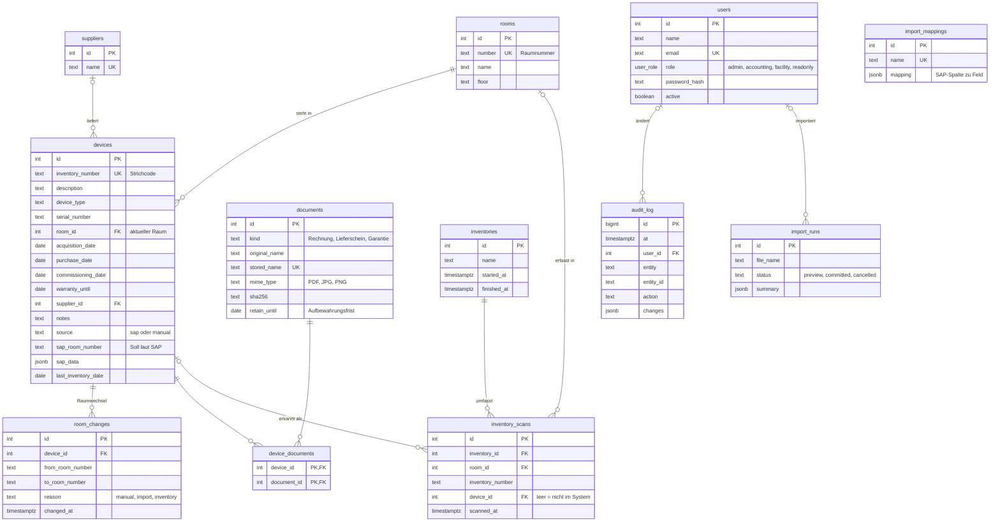

# Datenmodell

Grundlage ist das Pflichtenheft, Kapitel 4 (Speicherung in der DB). Das Schema steht in
[`server/src/db/migrations/001_grundschema.sql`](../server/src/db/migrations/001_grundschema.sql).

## Soll-Stand und Ist-Stand

- **Soll-Stand** = was laut SAP vorhanden ist. Er steht in `devices` in den Spalten `sap_room_number`,
  `sap_data` und `sap_imported_at` und wird nur vom SAP-Import geändert.
- **Aktueller Raum** = `devices.room_id`. Er ändert sich, wenn jemand ein Gerät umstellt oder eine
  Inventur übernommen wird. Jeder Wechsel landet mit Datum in `room_changes`.
- **Ist-Stand** = was bei der Inventur tatsächlich gefunden wurde: `inventory_scans`. Eine Erfassung
  kann auch eine Inventarnummer sein, die es im System nicht gibt (`device_id` ist dann leer).

Der Soll-Ist-Vergleich vergleicht `inventory_scans` mit dem Soll-Stand. Der SAP-Export gibt alle Geräte
aus, deren aktueller Raum vom Raum laut SAP abweicht oder die nicht aus SAP stammen.

## ER-Diagramm

GitHub und Visual Studio Code (mit Mermaid-Erweiterung) zeigen das Diagramm direkt an.

## Regeln in der Datenbank

| Regel                                                | Umsetzung                                                           |
| ---------------------------------------------------- | ------------------------------------------------------------------- |
| Inventarnummer und Raumnummer sind eindeutig         | `UNIQUE`                                                            |
| Jedes Gerät hat genau einen Raum                     | `devices.room_id NOT NULL`                                          |
| Raum mit Geräten kann nicht gelöscht werden          | Fremdschlüssel `ON DELETE RESTRICT` (zusätzlich Prüfung in der API) |
| Ein Beleg gehört zu mehreren Geräten                 | Zwischentabelle `device_documents`                                  |
| Belege in der Aufbewahrungsfrist sind nicht löschbar | Trigger `documents_protect_delete`                                  |
| Änderungsprotokoll ist nicht veränderbar             | Trigger `audit_log_no_change`                                       |
| Nur PDF, JPG und PNG                                 | `CHECK` auf `documents.mime_type` (zusätzlich Prüfung beim Upload)  |

## Schema ändern

Nie eine bestehende Migration ändern, sondern eine neue Datei anlegen, z. B.
`002_lieferanten_kontakt.sql`. Sie wird beim nächsten Start automatisch ausgeführt.
